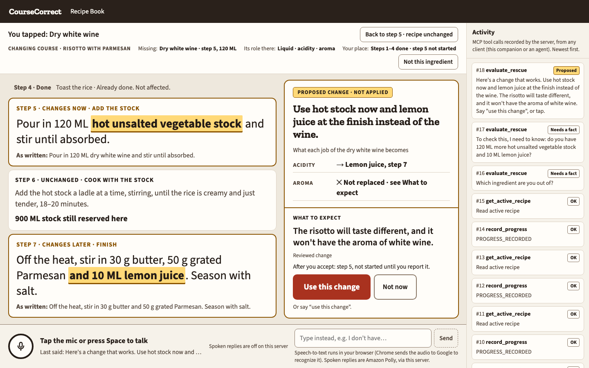
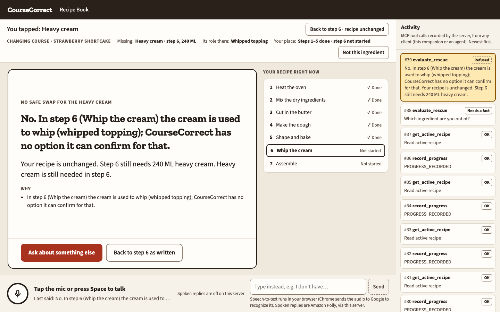
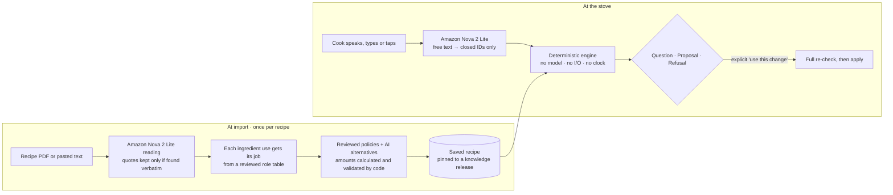
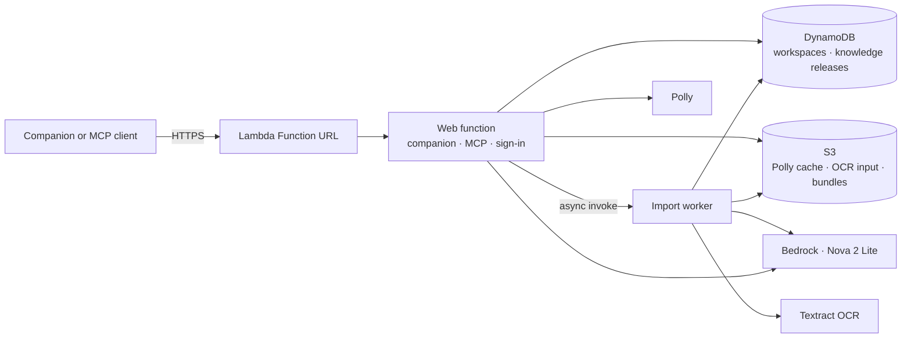

# CourseCorrect

A cook is five steps into a strawberry shortcake when they find the heavy cream is gone. They ask if milk and butter will do. In scone dough, they would: the cream there is liquid and fat, and milk and butter cover both jobs. In the shortcake, step 6 whips the cream, and milk and butter can't whip. The same swap is right in one recipe and wrong in the other, because what matters is the ingredient's job, not its name.

CourseCorrect is an MCP service that rescues a recipe partway through. It reads each recipe **once, at import**: Amazon Nova 2 Lite finds every ingredient use, and code gives each use its job and prepares checked alternatives. **At the stove**, a deterministic engine checks those alternatives against what the cook has already done. It answers with a question, a proposal, or a refusal that explains why, and changes the recipe only after the cook explicitly accepts. The model proposes, and code decides.

It runs as eight MCP tools over Streamable HTTP, with a browser companion that is itself an MCP client. You can run it on your own machine or deploy it to AWS Lambda.





## How it works



**Prepare at import.** The cook uploads a recipe PDF or pastes its text.
1. **Read.** Amazon Nova 2 Lite, through Amazon Bedrock Converse with one forced tool call, proposes the ingredients, steps and every ingredient use, quoting the source. Code keeps only quotes found verbatim in the source, and parses amounts from the source's own words.
2. **Give each use its job.** For example, liquid and fat in a dough, or aeration when whipped. The job comes from a reviewed role table when code can corroborate the ingredient and technique, never from the model's guess. When the recipe's own words leave a job open, the review asks the cook one question in those words.
3. **Bind reviewed policies.** Reviewed substitution policies bind to those jobs, and code calculates their amounts. Policies, vocabulary and roles come from a versioned **knowledge release**, and each import is pinned to the release that was active when it started.
4. **Draft AI alternatives.** Nova also drafts an alternative for every use, with one bounded correction round. Code validates each one, and drops any that fails a check or contradicts a reviewed rule.
5. **Save.** Saving writes an immutable recipe pack: the recipe model, every executable plan and the knowledge release it was compiled with. Cooking a saved recipe never calls the model again.

**Check and apply at the stove.** The cook marks progress, which only moves forward, and says or types what's missing.
1. **Interpret.** Nova turns free text into closed IDs only: which ingredient is missing, and what the cook proposes instead. Tapping the ingredient skips the model.
2. **Re-check.** The engine checks the saved plans against the live state: the right step, completed work protected, every other use of the ingredient covered, a valid recipe afterwards, and the amounts the cook must have on hand.
3. **Answer.** A clarifying question, a proposal with its consequence, or a refusal that says why ("No, because…") and leaves the recipe unchanged.
4. **Accept.** Answering a question never applies anything. Only an explicit "use this change" applies, and the engine re-runs the whole check first. Every affected instruction is rewritten, and no step is ever marked done for the cook.
5. **Change again.** Later changes are checked against the recipe as it is now, including ingredients an earlier change brought in. A change that would undo part of an earlier one is refused. Up to four changes per cooking session.

Spoken replies are Amazon Polly, synthesized on the server from text the service itself rendered.

### MCP tools

| Tool | What it does |
|---|---|
| `list_recipes` | Saved recipes, whether each can start, and which changes are on file |
| `start_recipe` | Start cooking; refuses while another session is active unless the cook confirms ending it |
| `get_active_recipe` | The active session, and whether a given command applied |
| `record_progress` | Mark a step started, partly done or done (forward only) |
| `evaluate_rescue` | What to do about a missing ingredient; never changes the recipe |
| `apply_amendment` | Apply the displayed change after explicit acceptance |
| `import_recipe` | Import pasted text or an uploaded PDF as a draft |
| `delete_recipe` | Archive a recipe; its cooking history is kept |

## Run locally

### Prerequisites

- Git.
- Node.js `22.18` or later, plus npm. The service runs TypeScript natively and uses the built-in `node:sqlite`.
- Desktop Chrome for voice input. Any current browser works with typed input.
- A free local port `8791`, or another set with `CC_PORT`.

No AWS account is needed to cook, rescue, refuse and apply on the bundled recipes. AWS is needed only for the optional live services (see [Turn on Amazon Nova and Polly](#turn-on-amazon-nova-and-polly)).

### Install and start

```bash
git clone https://github.com/markbrazinski/courseCorrectMCP.git
cd courseCorrectMCP
npm ci
npm start
```

`npm start` builds the companion into `dist/web`, then serves it. Successful startup ends with:

```text
CourseCorrectMCP on http://127.0.0.1:8791/ (MCP at /mcp) · interpreter NONE · explainer NONE · extractor OFF · swaps OFF · speech off · knowledge kr-… · packs …
```

In a second terminal:

```bash
curl -fsS http://127.0.0.1:8791/health
# {"ok":true,"interpreter":"NONE","speech":"off","knowledge":"kr-…"}
```

### Try a rescue

Open [http://127.0.0.1:8791/](http://127.0.0.1:8791/). The Recipe Book lists **Risotto with Parmesan** and **Strawberry Shortcake**. With no AWS configured, CourseCorrect asks which ingredient is missing, and you tap it.

- **Risotto, the wine.** Open the risotto, select **Start cooking**, and select **Done** on steps 1–4. Type "I don't have any white wine", then tap **Dry white wine**. CourseCorrect asks whether you have 120 ML more hot stock and 10 ML lemon juice. Answer **Yes**: the wine's two jobs split, step 5 becomes hot stock now and step 7 gains lemon juice at the finish. Select **Use this change** to apply it.
- **Shortcake, the cream.** Start the shortcake and select **Done** on steps 1–5. Type "I'm out of heavy cream", then tap **Heavy cream**. Step 6 whips the cream, so the answer is "No", with the reason, and the recipe is unchanged.
- **Scones, the cream again.** In **Add a recipe**, the **Cream Scones · sample PDF** chip imports [`samples/scones-explicit.pdf`](samples/scones-explicit.pdf). Reading a recipe needs Amazon Nova (`CC_EXTRACTOR=live`). Once it's saved, cream at step 3 can be replaced with milk and butter, and both the dough step and the brushing step change.

The **Activity** column shows every MCP call the server recorded, from the companion or any other client.

### Connect an MCP client

The MCP endpoint is `http://127.0.0.1:8791/mcp` (Streamable HTTP, stateless). For example, with Claude Code:

```bash
claude mcp add --transport http coursecorrect http://127.0.0.1:8791/mcp
```

Browser requests are accepted only from `http://127.0.0.1:<port>` or `http://localhost:<port>`. Other origins get `403`.

### Turn on Amazon Nova and Polly

Each live service is a separate setting, and any subset works. Live calls are paid.

You need:
- an AWS account with Amazon Bedrock access to the Amazon Nova 2 Lite US inference profile (`us.amazon.nova-2-lite-v1:0`) in `us-east-1`, and Amazon Polly for spoken replies;
- a non-root IAM user or role, configured as an AWS CLI profile, allowed `bedrock:InvokeModel`, `polly:SynthesizeSpeech` and `sts:GetCallerIdentity`;
- a spending authorization: the caps every live call is reserved against before it's made.

Create the spending authorization from the tracked template. The `private/` folder is git-ignored.

```bash
mkdir -p private/architecture
cp authorization.example.json private/architecture/authorization.json
# edit it: set "profile" to your AWS CLI profile, and adjust the caps
```

Start with the services you want, naming your AWS identity in `CC_AWS_IDENTITY` (`user/<iam-user-name>` or `role/<role-name>`). The service checks it with STS before any live call, and refuses root.

```bash
CC_LIVE=1 CC_AUTHORIZATION=authorization.json CC_AWS_IDENTITY=user/<iam-user-name> \
CC_EXTRACTOR=live CC_ANALYZER=live CC_INTERPRETER=nova CC_SPEECH=polly \
CC_OWNER_TOKEN=<choose-a-key> npm start
```

Live startup prints `live AWS identity IAM_USER(<name>) · authorization local-1` before the server line. Then try the scone import above, or type a request in your own words.

| Setting | Values | What it turns on |
|---|---|---|
| `CC_EXTRACTOR` | `none` · `live` | Reading a recipe at import |
| `CC_ANALYZER` | `none` · `live` | AI alternatives at import |
| `CC_INTERPRETER` | `none` · `nova` | Free-text requests ("Can I use lemon juice?") |
| `CC_EXPLAINER` | `none` · `nova` | Nova wording for refusal reasons (the engine's facts are always the source) |
| `CC_SPEECH` | `off` · `polly` | Spoken replies |

**Costs at list price, measured in earlier runs:**

| Item | Cost |
|---|---|
| One import (reading, AI alternatives and the correction round) | about $0.01 |
| One interpreted request | about $0.001 |
| One spoken reply (Polly, $16 per 1M characters) | about $0.0014 |

Every setting and route is described in [SETUP.md](SETUP.md).

### Verification

These need no AWS account and make no paid calls:

```bash
npm run typecheck
npm test                          # acceptance suite: 278 passed, 3 skipped (DynamoDB Local)
npm run walkthrough               # a real MCP client over HTTP: ALL CHECKS PASSED
npx playwright install chromium   # once
npm run e2e                       # browser journeys: 28 passed, 1 skipped
```

The browser journeys start a separate test server, [`tests/support/server.ts`](tests/support/server.ts), which wires recorded readings, alternatives and intents into the real service code, so the journeys are repeatable without paid calls. The product's entry point never loads them.

To run the acceptance suite against DynamoDB as well, start DynamoDB Local on port 8000 (for example `docker run -p 8000:8000 amazon/dynamodb-local`) and run `npm run test:dynamodb-local`.

### Troubleshooting and shutdown

- **`CC_EXTRACTOR=<value>: expected none or live`**, or the same for another setting: only the values in the table above are accepted.
- **`refusing live calls: AWS identity is …`:** set `CC_AWS_IDENTITY` to the IAM user or role your profile resolves to. Root is always refused.
- **A missing authorization file on a live start:** create it as in [Turn on Amazon Nova and Polly](#turn-on-amazon-nova-and-polly), and name it with `CC_AUTHORIZATION`.
- **`BUDGET_EXCEEDED`, or "Spoken reply unavailable":** a cap in the authorization was reached. Raise it and restart. Every live call is reserved first in `.artifacts/ledger/nova-ledger.jsonl`, and nothing is retried.
- **The import says live reading is required:** `CC_EXTRACTOR` is `none`, which is the default.
- **"That PDF has no readable text":** locally, PDFs are read from their text layer. Paste the recipe text instead; the AWS deployment adds Amazon Textract OCR. PDFs can be up to 10 MB and 20 pages.
- **"Microphone unavailable":** the browser has no speech recognition (Firefox, for example), or microphone permission was denied. Type instead.
- **Port `8791` is busy:** set `CC_PORT`, and open the companion on that port.
- **To start over:** with `CC_OWNER_TOKEN` set, `curl -fsS -X POST -H "Authorization: Bearer <token>" http://127.0.0.1:8791/admin/start-over` moves the kitchen to a new, empty workspace. The bundled recipes stay.
- **To stop:** press Ctrl-C. State lives in `.artifacts/runtime/` (set with `CC_DB`), Polly clips in `.artifacts/speech-cache/`, and the ledger in `.artifacts/ledger/`, all git-ignored. On restart, state is kept, and an interrupted import or check is reported as interrupted, never re-applied.

## Deploy to AWS

The same service runs on AWS Lambda, defined in two CloudFormation templates in [`infra/`](infra/) and driven by one CLI, `npm run cc`.



- **`cc-<env>-data`:** two on-demand DynamoDB tables (workspaces, and knowledge releases) and a private S3 bucket.
- **`cc-<env>-app`:** the web and import-worker functions (Node.js 24), a public HTTPS Function URL, their IAM role and log groups.

Each sign-in with the environment's access code opens its own workspace. Nothing charges while idle except stored data.

**You need:**
- AWS CLI v2 and `zip`;
- an AWS CLI profile for a non-root IAM user or role that may manage CloudFormation, Lambda, IAM roles, DynamoDB, S3 and CloudWatch Logs in `us-east-1`;
- Bedrock access to Nova 2 Lite, only if you turn on live services.

```bash
npm run cc -- init     --env myenv --profile <aws-profile>   # private/deploy/myenv/: config, secrets, a zero-cap spending authorization
npm run cc -- deploy   --env myenv                           # builds the bundle, creates the data stack, then stops: no knowledge release yet
npm run cc -- knowledge publish --env myenv --activate       # content/approved → an immutable, verified knowledge release
npm run cc -- deploy   --env myenv                           # creates the app stack; prints the URL
npm run cc -- verify   --env myenv                           # smoke checks against the URL
```

The access code is in `private/deploy/myenv/secrets.json`. Paid services stay off until you turn them on in `private/deploy/myenv/config.json` (`modes`, including `ocr: textract`) and give `authorization.json` caps, overall and per workspace; then deploy again. To change only the caps later, run `npm run cc -- allowances --env myenv --apply`.

For judges or invited testers, `secrets.json` also holds a `judgeCode`. The link `<URL>?code=<judgeCode>` opens the sign-in page with that code filled in and one **Start cooking** button, so nothing signs in until someone presses it. Workspaces opened with it spend from their own allowance (`tiers.judge` in `authorization.json`), separate from the regular code's caps.

To use the deployment from an MCP client, select **MCP client** in the companion after signing in, or `POST /signin` with `{"code": "…"}` as JSON. Send the token it returns as `Authorization: Bearer …` to `/mcp`.

The same CLI runs `status`, `backup`, `restore`, `destroy`, `maintenance`, and an emergency `stop` and `start`. See [SETUP.md](SETUP.md#deploy-to-aws-lambda) for every command.

## Technologies and dependencies

- **Node.js** `>=22.18` runs the TypeScript service natively (type stripping). State is a key-value store with serializable per-workspace transactions: locally one SQLite file through `node:sqlite`; deployed, Amazon DynamoDB.
- **`@modelcontextprotocol/sdk`** `1.30.1` serves the eight MCP tools over stateless Streamable HTTP (protocol `2025-11-25`).
- **Amazon Bedrock Converse** with the US Amazon Nova 2 Lite inference profile `us.amazon.nova-2-lite-v1:0` in `us-east-1`, for recipe reading, AI alternatives, request interpretation and optional refusal wording. Temperature 0, one forced tool call per request, never retried.
- **Amazon Polly:** the neural voice Joanna, MP3, cached by the exact text.
- **Amazon Textract** (deployed): `DetectDocumentText` for PDF pages without a text layer.
- **AWS Lambda, Amazon DynamoDB, Amazon S3 and AWS CloudFormation** for the deployment. **AWS SDK for JavaScript v3** `3.1145.0` and **AWS CLI v2**.
- **`pdfjs-dist`** `^6.3.289` extracts PDF text layers in an isolated worker thread.
- **`zod`** `4.6.5` validates tool inputs and model output.
- **`@hono/node-server`** `2.1.3` adapts the HTTP routes to Node and Lambda.
- **React** `19.3.0` and **Vite** `8.3.2` build the companion. Voice input is the browser's Web Speech API.
- **TypeScript** `7.0.2`, **Vitest** `4.1.11` and **Playwright** `1.63.0` for checks and browser journeys.

## Repository structure

```text
src/authoring/       import: PDF and text intake, Nova reading and AI alternatives, Textract OCR, drafts, save
src/compile/         reviewed policies → executable plans with calculated amounts; AI alternative validation
src/engine/          deterministic evaluation, apply and progress (no I/O, no clock, no model)
src/contract/        wire projections: per-use analysis, refusal reasons, candidates
src/domain/          recipe, vocabulary and exact-number helpers
src/knowledge/       knowledge releases: publish, verify and load immutable releases
src/service/         local and Lambda entry points, MCP tools, HTTP routes, sign-in, SQLite and DynamoDB stores, Polly
src/ops/             the deployment CLI (npm run cc) and deployed-environment checks
src/web/             the React companion (an MCP client)
infra/               CloudFormation templates: data stack and app stack
content/approved/    vocabulary, role table, substitution policies and the bundled recipes
content/proposed/    knowledge packets under review; never loaded by the service
samples/             the sample scone recipe PDF
tests/               acceptance (Vitest), browser journeys (Playwright), fixtures and the test server
```

`src/probes/` and `src/walkthrough-m2.ts` are maintainer tooling that replays data kept outside the repository. Nothing in the product uses them.

## License

Apache-2.0. See [`LICENSE`](LICENSE).

## Scope

- **Nova proposes; code decides.** Model output is untrusted until code validates it. The model never selects a plan, calculates a reviewed amount, judges eligibility or applies a change. A failed check is shown as failed, and an unavailable service is reported, never filled in.
- **Spending is capped before it happens.** Every paid call is reserved against an authorization's call and dollar caps, and never retried.
- **One kitchen per local server.** Locally, the service listens on `127.0.0.1` with no sign-in. Deployed, an access code opens a separate workspace per sign-in, and MCP clients use a bearer token.
- **Input.** Speech recognition is the browser's own (desktop Chrome sends audio to its speech service). Locally, PDFs are read from their text layer; the deployment adds Textract OCR.
